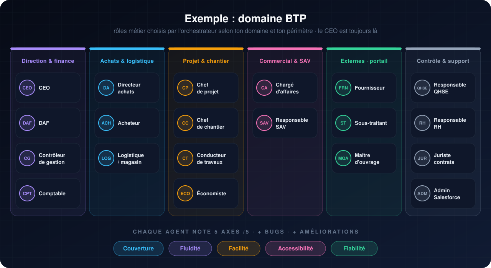
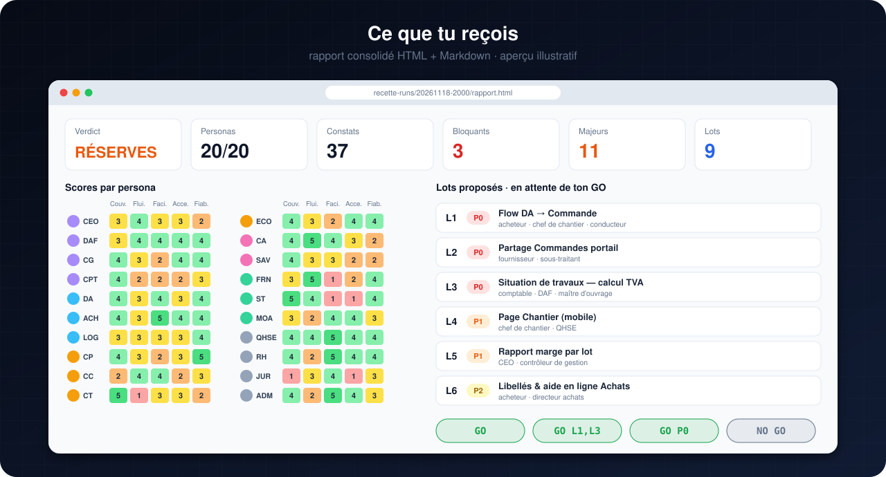

<p align="center"></p>

<p align="center"></p>

<p align="center"></p>

<p align="center"></p>

## ⚡ Installer

**Claude Code**
```bash
git clone https://github.com/azamiji/sf-recette-multiagents ~/sf-recette-multiagents
ln -s ~/sf-recette-multiagents/skills/review-multi-agent ~/.claude/skills/review-multi-agent
```

**Chat Claude** — téléverser le dossier `skills/review-multi-agent` (zippé) dans *Paramètres → Skills*.

## ▶️ Lancer

```text
/review-multi-agent
```
```text
/review-multi-agent banque — uniquement l'app Sales
```
```text
GO        GO L1,L3        GO P0        NO GO
```

<sub>Prérequis : MCP Salesforce (DX, MCP d'org ou <code>sf</code> CLI) · MCP navigateur recommandé · une sandbox (lecture seule en production).</sub>
