<p align="center"></p>

<p align="center"></p>

<p align="center"></p>

<p align="center"></p>

## ⚡ Installer

```bash
git clone https://github.com/azamiji/sf-recette-multiagents ~/sf-recette-multiagents
ln -s ~/sf-recette-multiagents/skills/sf-recette-multiagents ~/.claude/skills/sf-recette-multiagents
```

## ▶️ Lancer

```text
Lance la recette de mon app Salesforce sur la sandbox uat avec les 20 personas BTP
```

```text
GO        GO L1,L3        GO P0        NO GO
```

<sub>Prérequis : Claude Code · Salesforce DX MCP ou <code>sf</code> CLI · MCP navigateur recommandé · une sandbox (lecture seule en production).</sub>
