<p align="center"></p>

## 🧭 Les commandes

| Tu tapes | Ce qui se passe |
|---|---|
| `/review-multi-agent` | 3 questions : **domaine** · **nombre d'agents (3–20)** · **consigne** (facultative) |
| `/review-multi-agent banque, 8 agents — uniquement l'app Sales` | Lance directement, sans questions |
| `GO` | Lance toutes les corrections |
| `GO L1,L3` | Seulement les lots L1 et L3 |
| `GO P0` | Seulement les bloquants |
| `NO GO` | Rien n'est modifié dans ton org Salesforce |

<p align="center"></p>

<p align="center"></p>

<p align="center"></p>

## ✅ Ce qu'il faut

| | |
|---|---|
| ☁️ **Org Salesforce** | une **sandbox** (en production : lecture seule) |
| 🔌 **MCP Salesforce** | déjà configuré — un seul utilisateur pour tous les agents |
| 🧹 **Droit de suppression** | les données de test sont créées puis **supprimées** après les tests |
| 🌐 **MCP navigateur** | facultatif, pour juger l'écran (fluidité, accessibilité) |

## ⚡ Installer

**Claude Code**
```bash
git clone https://github.com/azamiji/sf-recette-multiagents ~/sf-recette-multiagents
ln -s ~/sf-recette-multiagents/skills/review-multi-agent ~/.claude/skills/review-multi-agent
```

**Chat Claude** : *Paramètres → Skills → Importer* le fichier `review-multi-agent.skill` (ou le dossier `skills/review-multi-agent` zippé).
